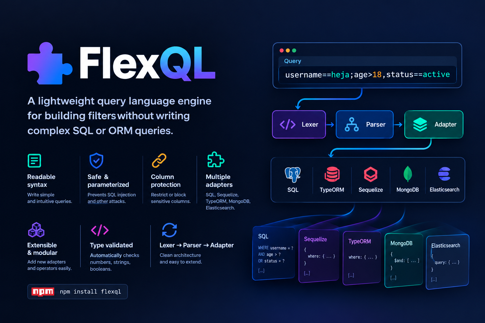

# FlexQL

<p align="center">
  
</p>

<p align="center">A small, adapter-based query language for readable database filters.</p>

## Why FlexQL?

FlexQL converts simple filter strings into structured SQL, Sequelize, MongoDB, Elasticsearch, or TypeORM-ready conditions. It helps you avoid repeating filter parsing logic in every API endpoint.

- Readable query syntax for API filters
- Parameterized SQL values
- Protected columns and operator rules
- One syntax for multiple database adapters
- TypeScript support with generated declarations
- Parenthesized nested expressions with a configurable depth limit

## Installation

```bash
npm install @xeja/flexql
```

## Quick start

```ts
import { FlexQL } from "flexql";

const flexql = new FlexQL();
const result = flexql.parse("username==ali;age>18,status==active", {
  adapter: "sql",
});

console.log(result);
```

```ts
{
  type: "sql",
  payload: {
    conditions: "( username = ? AND age > ? ) OR status = ?",
    values: ["ali", 18, "active"]
  }
}
```

Values are returned separately from SQL conditions. Pass them to your database driver; do not interpolate them into SQL strings.

## Query syntax

| Syntax | Meaning |
| --- | --- |
| `==` | equals |
| `!=` | not equals |
| `>` / `<` | greater / less than |
| `>=` / `<=` | greater or equal / less or equal |
| `,` | OR |
| `;` | AND |

```text
country==TR,country==DE;age>=18
```

This means:

```text
(country == "TR" OR country == "DE") AND age >= 18
```

Parentheses can be used to create nested groups. The default maximum nesting depth is `3`:

```ts
const result = flexql.parse("status==active;(price>=100000,featured==true)", {
  adapter: "elasticsearch",
  maxDepth: 5,
});
```

Numbers and booleans are parsed automatically:

```text
price>=100000;active==true
```

## Adapters

### SQL

```ts
const result = flexql.parse("status==active;age>=18", { adapter: "sql" });

const rows = await db.query(
  `SELECT * FROM users WHERE ${result.payload.conditions}`,
  result.payload.values,
);
```

### Sequelize

```ts
const result = flexql.parse("status==active;age>=18", {
  adapter: "sequelize",
});

const users = await User.findAll({ where: result.payload.conditions });
```

### MongoDB

```ts
const result = flexql.parse("status==active;age>=18", { adapter: "mongo" });
const users = await collection.find(result.payload).toArray();
```

### Elasticsearch

```ts
const result = flexql.parse("status==active;age>=18", {
  adapter: "elasticsearch",
});

const response = await client.search({
  index: "users",
  query: result.payload.conditions,
});
```

### TypeORM

```ts
const result = flexql.parse("status==active;age>=18", {
  adapter: "typeorm",
});

const users = await userRepository
  .createQueryBuilder("user")
  .where(result.payload.conditions.where, result.payload.conditions.parameters)
  .getMany();
```

The TypeORM adapter returns a dependency-free QueryBuilder condition and named parameters.

## Protecting columns

```ts
const result = flexql.parse("email==user@example.com;age>18", {
  adapter: "sql",
  columnProtect: {
    exclude: ["password", "token"],
    rules: {
      email: ["=="],
      age: [">", ">=", "<", "<="],
    },
  },
});
```

## Custom separators

```ts
const result = flexql.parse("status==active|age>18", {
  adapter: "sql",
  separators: { and: "|", or: "&" },
});
```

## How it works

```text
Query string → Lexer → Parser → AST → Adapter output
```

## Development

```bash
npm install
npm test
npm run typecheck
npm run build
```

Other useful scripts:

```bash
npm run test:watch
npm run test:coverage
```

## Project status

Currently supported adapters:

- SQL
- Sequelize
- MongoDB
- Elasticsearch
- TypeORM

The syntax intentionally stays small and supports nested parentheses with a configurable depth limit.

## Contributing

Bug reports, tests, improvements, and new adapters are welcome. Please open an issue or pull request with a clear description and relevant test coverage.

## License

ISC. See [LICENSE](LICENSE).
